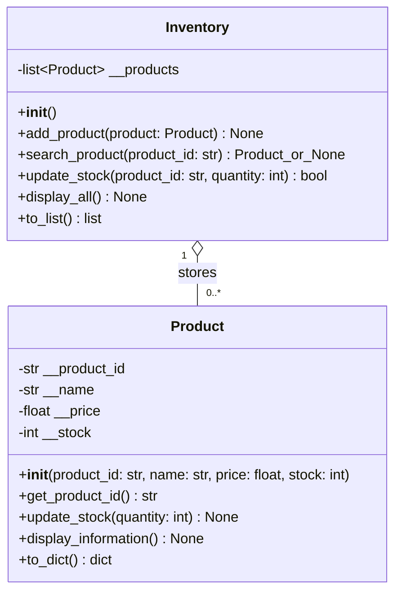

# Week 8 UML class diagram

`-` means private; `+` means public. Inventory stores Product objects.

Product owns and validates its data. Inventory manages the collection. The main
program handles input and menu choices; separate functions load and save JSON.
Only dictionaries at the file boundary are serialized; products in memory are objects.
